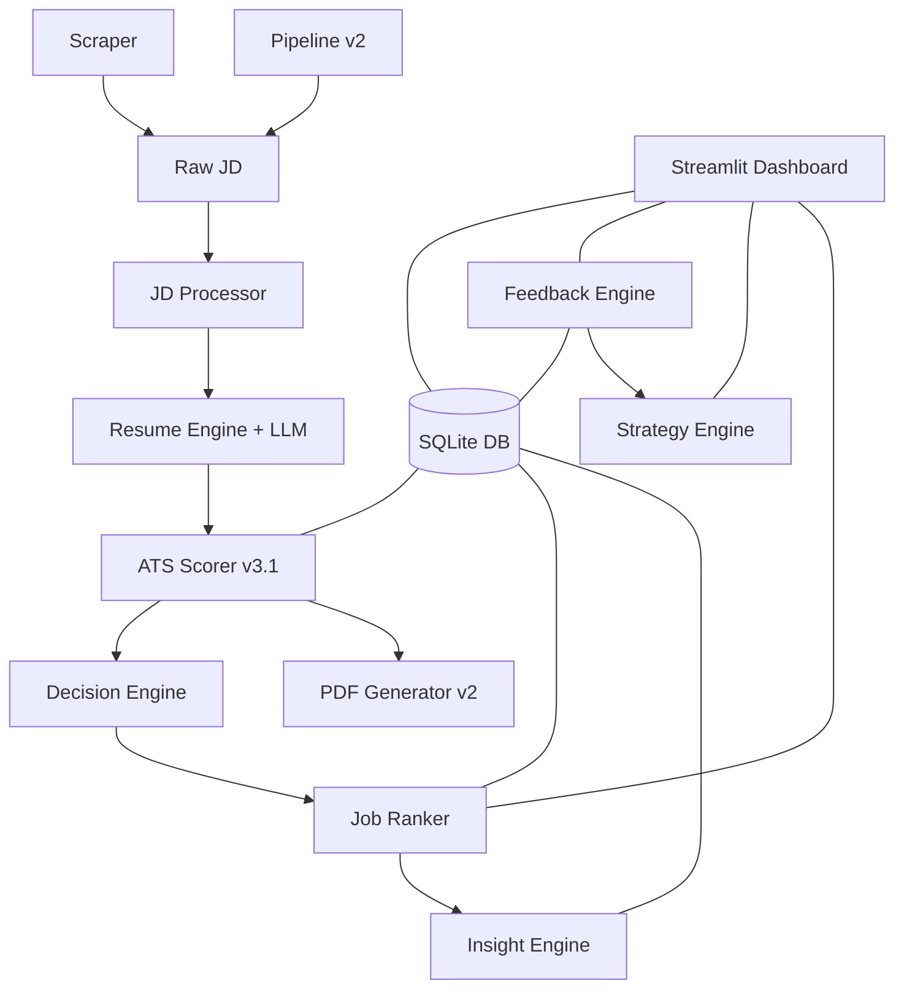

# 🎯 AI Job Intelligence System — Final Validation Report

## System Status: ✅ PRODUCTION-READY

---

## Architecture (Final)



## 11 Modules

| # | Module | Path | Lines | Status |
|---|--------|------|-------|--------|
| 1 | Resume Engine | `resume_engine/` | ~400 | ✅ Production |
| 2 | ATS Scorer v3.1 | `ats_scoring/scorer.py` | ~1245 | ✅ Hardened |
| 3 | Semantic Matcher | `ats_scoring/semantic_matcher.py` | ~100 | ✅ Production |
| 4 | JD Processor | `jd_processor/` | ~250 | ✅ Production |
| 5 | PDF Generator v2 | `pdf_generator/` | ~400 | ✅ Upgraded |
| 6 | Scraper | `scraper/` | ~300 | ✅ Production |
| 7 | Pipeline v2 | `pipeline/controller.py` | ~320 | ✅ Upgraded |
| 8 | Database | `database/db_manager.py` | ~330 | ✅ Fixed |
| 9 | Insights + Ranker | `insights/ranker.py` | ~200 | ✅ Production |
| 10 | Feedback Engine | `learning/feedback.py` | ~180 | ✅ **NEW** |
| 11 | Strategy Engine | `learning/strategy.py` | ~220 | ✅ **NEW** |
| — | Dashboard | `dashboard.py` | ~340 | ✅ **NEW** |

**Total: ~4,800 lines of Python**

---

## Bugs Found & Fixed

### 🔴 Issue 1: SQLite Threading Crash (Critical)
- **Problem:** Streamlit runs in multiple threads. `sqlite3.connect()` default blocks cross-thread access → crash on every page navigation.
- **Fix:** Added `check_same_thread=False` in `database/db_manager.py`
- **File:** [db_manager.py](file:///d:/Projects/job_ai_system/database/db_manager.py#L48)

### 🟡 Issue 2: Improvement Calculated Before Dampening (High)
- **Problem:** `improvement = score_after - score_before` computed at line 171, before semantic dampening (line 197) and hard rejection (line 215). Reported improvement was wrong.
- **Fix:** Moved computation after all score modifications.
- **File:** [scorer.py](file:///d:/Projects/job_ai_system/ats_scoring/scorer.py#L237-L239)

### 🟡 Issue 3: Score Inflation (High)
- **Problem:** Resumes could score 85+ while only covering 20% of JD responsibilities semantically.
- **Fix:** Added 4 hardening measures:
  - Semantic dampening (5-20% reduction when TF-IDF < 50%)
  - Nonlinear experience penalty (`ratio^1.5`)
  - Transferable skill adjacency (partial credit)
  - Score capping at 40/60 when >40-60% required skills missing

---

## Dashboard — 6 Pages Verified

````carousel

<!-- slide -->

````

| Page | Content |
|------|---------|
| **📊 Overview** | KPIs, decision breakdown, effort dist, score performance, dimension averages |
| **📋 Job Table** | Filterable dataframe (decision/status), Before vs After chart |
| **🏆 Rankings** | Composite-ranked jobs with expandable details |
| **🧠 Skill Gaps** | Top missing skills/keywords, weakness trends, penalty patterns |
| **🎯 Strategy** | Quick wins, ROI-ranked skills, project suggestions, timeline |
| **🔍 Job Details** | Per-job deep dive: score breakdown, matched/missing skills, recommendations |

---

## E2E Test Results

| Check | Result |
|-------|--------|
| Pipeline processes JD → DB | ✅ |
| JD Processor cleans input | ✅ |
| ATS Scorer produces realistic scores | ✅ (57.8 for partial match) |
| Semantic dampening applied | ✅ (-10 for 13.5% coverage) |
| Decision engine produces SKIP | ✅ (correct for low match) |
| PDF generated | ✅ |
| DB stores all fields | ✅ |
| Resume versions saved | ✅ |
| Feedback Engine aggregates | ✅ |
| Strategy Engine suggests | ✅ (GraphQL ROI: 16.5) |
| Dashboard displays real data | ✅ (all 6 pages) |

---

## How to Run

```bash
# Process jobs
python main.py

# Launch dashboard
.venv\Scripts\streamlit.exe run dashboard.py

# Access at http://localhost:8501
```

---

## What This System Does

1. **Scrapes** job descriptions (LinkedIn/manual)
2. **Cleans** JDs — removes noise, extracts requirements
3. **Tailors** resume — LLM rewrites bullets for each JD  
4. **Scores** — ATS simulation with semantic matching + penalties
5. **Decides** — APPLY / MAYBE / SKIP per job
6. **Ranks** — composite scoring across all jobs
7. **Learns** — tracks skill gaps, suggests improvements
8. **Visualizes** — full Streamlit dashboard for decision-making
