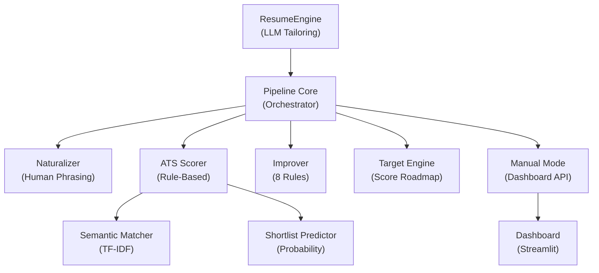

# 🔍 System Audit v3 — 14-Part Gap Analysis

## Current System Architecture

---

## Gap Analysis — 14 Parts vs Current State

| Part | Requirement | Status | Gap Severity |
|------|------------|--------|-------------|
| **1** | Context-Aware Experience Engine | ✅ **Partial** — `SKILL_CATEGORIES` + `_skill_fits_bullet` exist | 🟡 MEDIUM — No tool-purpose enforcement |
| **2** | Tool Purpose Enforcement | ❌ **Missing** — Tools injected without purpose | 🔴 HIGH |
| **3** | Remove Fake Signals | ✅ **Partial** — Blocklist exists, but "using X" w/o context passes | 🟡 MEDIUM |
| **4** | Universal Role Engine | ❌ **Missing** — System is tech-biased, no role classification | 🔴 CRITICAL |
| **5** | Professional Summary Engine | ❌ **Missing** — `_strengthen_summary` only weaves keywords | 🔴 CRITICAL |
| **6** | Final Polish Engine | ❌ **Missing** — No auto-polish after score ≥80 | 🔴 HIGH |
| **7** | Recommendation Execution | ✅ **Exists** — `_execute_recommendations` works for [MUST] tags | 🟢 OK |
| **8** | User Trust Layer | ❌ **Missing** — No change explanations or trust indicators | 🔴 HIGH |
| **9** | User Control (Modes) | ✅ **Partial** — `strict` vs `balanced` exists in pipeline | 🟡 MEDIUM — Missing "conservative" + accept/reject |
| **10** | Real-World Intelligence | ❌ **Missing** — No resume type detection (fresher/switcher/etc) | 🔴 HIGH |
| **11** | Job Intelligence | ✅ **Exists** — Decision engine + probability + ranker exist | 🟢 OK |
| **12** | Feedback Loop | ✅ **Exists** — `FeedbackEngine` + `StrategyEngine` exist | 🟢 OK |
| **13** | Final Validation | ✅ **Partial** — Guardrails exist but no final rejection gate | 🟡 MEDIUM |
| **14** | Universal Testing | ❌ **Missing** — No multi-role test framework | 🔴 HIGH |

---

## Detailed Gap Analysis

### 🔴 Part 2: Tool Purpose Enforcement
**Current**: `PURPOSE_PHRASES` dict exists but only appends to bullets. No structured `{tool, purpose}` enforcement.
**Gap**: Skills get injected as "leveraging X" without explaining WHY.
**Fix**: Add purpose-aware injection — every skill mention must include context.

### 🔴 Part 4: Universal Role Engine  
**Current**: `SKILL_CATEGORIES` only has tech categories. No role classification.
**Gap**: HR/BPO/Mechanic JDs will get Python/ML skills injected.
**Fix**: Add `classify_role()` function + role-specific behavior adaptation.

### 🔴 Part 5: Professional Summary Engine
**Current**: `_strengthen_summary()` only appends keywords. No structured format.
**Gap**: Summaries remain generic. No `[Role] + [Specialization] + [Skills] + [Impact]` template.
**Fix**: Add `_generate_professional_summary()` with role-aware template.

### 🔴 Part 6: Final Polish Engine
**Current**: Pipeline stops after optimization. No polish step.
**Gap**: Score ≥80 resumes still have redundancy, weak verbs, formatting issues.
**Fix**: Add `polish_resume()` triggered after optimization when score ≥80.

### 🔴 Part 8: User Trust Layer
**Current**: Changes are logged but not exposed to user.
**Gap**: User has no visibility into what changed and why.
**Fix**: Add `ChangeExplanation` model to pipeline result.

### 🔴 Part 10: Real-World Intelligence
**Current**: No resume type detection.
**Gap**: System treats freshers and experienced candidates identically.
**Fix**: Add `detect_resume_type()` + adaptive strategy.

---

## Implementation Plan — Priority Order

1. **Role Engine** (Part 4) — Foundation for everything. Without this, non-tech roles break.
2. **Summary Engine** (Part 5) — Highest visibility fix. Users see this first.
3. **Tool Purpose Enforcement** (Part 2) — Eliminates "using X" without context.
4. **Polish Engine** (Part 6) — Final quality pass.
5. **Resume Type Detection** (Part 10) — Adaptive strategy.
6. **Trust Layer** (Part 8) — Change explanations in pipeline result.
7. **Fake Signal Removal** (Part 3) — Tighten blocklist.
8. **Final Validation Gate** (Part 13) — Reject output if quality fails.
9. **User Control Modes** (Part 9) — Add "conservative" mode.
10. **Universal Testing** (Part 14) — Multi-role test cases.

> [!IMPORTANT]
> All changes are INCREMENTAL — no architecture rewrites. Each part is a self-contained module addition or method upgrade to existing classes.
