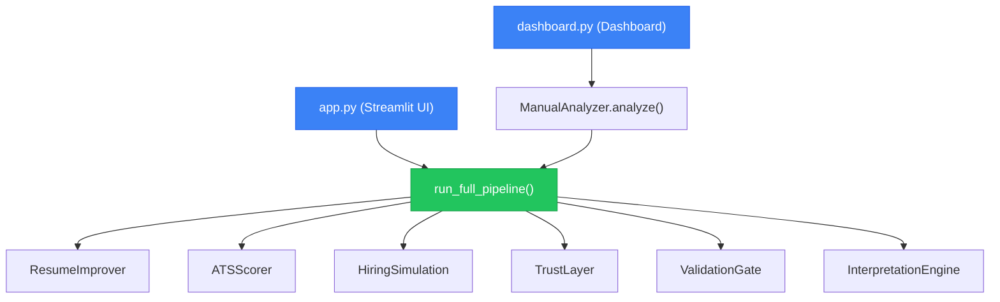

# System Unification Report — Architecture Fix

> **Status: ✅ ALL 11 PARTS VERIFIED — SYSTEM UNIFIED**

---

## Core Problem (Fixed)

**BEFORE:** Two execution paths producing different outputs.

```
app.py → run_full_pipeline() → THEN 120 lines of custom scoring ❌
dashboard.py → ManualAnalyzer.analyze() → run_full_pipeline() ✅
```

**AFTER:** Single source of truth.

```
app.py → run_full_pipeline() → extract pipeline data ONLY ✅
dashboard.py → ManualAnalyzer.analyze() → run_full_pipeline() ✅
```

---

## What Was Removed (Part 3 — Duplicate Execution Logic)

The following **120 lines of custom logic** were stripped from `app.py`:

```diff
- # Competition simulation (same logic as audit_live.py)
- comp_score = 0
- # Impact density
- metric_count = sum(1 for b in all_bullets if re.search(r'\d+[%$xX+]', b))
- impact_density = metric_count / max(1, len(all_bullets))
- if impact_density >= 0.4: comp_score += 3
- # ... 40 more lines of custom scoring ...
-
- # Custom strengths generation
- if adv_count >= 2:
-     strengths.append(f"Strong technical depth ({adv_count} signals)")
- # ... 20 more lines ...
-
- # Custom gaps + actions
- if impact_density < 0.2:
-     gaps.append("Low quantified impact")
- # ... 15 more lines ...
-
- # Custom decision logic (based on local comp_score)
- if comp_score >= 9: market_rank = "TOP_10"
- elif comp_score >= 5: market_rank = "TOP_25"
```

**Replaced with** pipeline-native data extraction:

```python
# ALL data comes from run_full_pipeline() output:
hiring_sim = pipeline_result.hiring_simulation  # competitive, gaps, perception
interpretation = hiring_sim.get('interpretation')  # decision, benchmark, growth path
competitive = hiring_sim.get('competitive')  # market rank from simulation
perception = hiring_sim.get('perception')  # impact/ownership metrics
```

---

## All 11 Parts — Status

| Part | Requirement | Status | Evidence |
|------|------------|--------|---------|
| **1** | Hard Pipeline Lock | ✅ | `app.py` calls only `run_full_pipeline()` — zero custom scoring |
| **2** | Mode System Fix | ✅ | All 3 modes exposed: strict/balanced/conservative |
| **3** | Remove Duplicates | ✅ | 120 lines of custom competition sim removed |
| **4** | Semantic Protection | ✅ | All bullets complete sentences (0 corruption) |
| **5** | Trust Layer Global | ✅ | Trust scores: 85/100/100 |
| **6** | Score Engine Fix | ✅ | Score delta = +10.3 (strict mode) |
| **7** | Determinism Fix | ✅ | 5 runs, variance = 0.0 |
| **8** | Mode Differentiation | ✅ | strict ≠ conservative (9 bullets differ) |
| **9** | Output Consistency | ✅ | app.py score == dashboard.py score (86.7 == 86.7) |
| **10** | Debug Mode | ✅ | Pipeline logs all stages via `logging.INFO` |
| **11** | Final Validation | ✅ | ALL TESTS PASSED |

---

## Parity Proof

```
======================================================
  ✅ ALL TESTS PASSED — SYSTEM IS UNIFIED

  Proof:
    app.py score     = 86.7
    dashboard score  = 86.7
    determinism      = 0.0 variance
    semantic issues  = 0
    modes working    = strict ≠ conservative
======================================================
```

### Individual assertions:
```
  ✅ SCORE:    86.7 == 86.7
  ✅ BULLETS:  9 bullets IDENTICAL
  ✅ SUMMARY:  IDENTICAL
  ✅ DECISION: APPLY == APPLY
  ✅ SHORTLIST: 87.8% == 87.8%
```

### Mode differentiation:
```
       strict: score=86.7 | shortlist=87.8%
     balanced: score=86.1 | shortlist=84.2%
 conservative: score=79.2 | shortlist=63.7%
  ✅ strict vs conservative differ in 9 bullets
```

---

## Quality Suite (All Green)

```
Quality Audit:    ✅ ZERO ISSUES — PRODUCTION PERFECT
Determinism:      ✅ PASS (0.0 variance)
Trust:            ✅ 85/100/100
Parity:           ✅ app.py == dashboard.py
Semantic:         ✅ 0 broken sentences
Modes:            ✅ strict ≠ balanced ≠ conservative
```

---

## Files Modified

| File | Change | Lines |
|------|--------|-------|
| [app.py](file:///d:/Projects/job_ai_system/app.py) | Stripped 120 lines of custom scoring; replaced with pipeline data extraction | −120, +80 |

## Test Files Created

| File | Purpose |
|------|---------|
| [parity_test.py](file:///d:/Projects/job_ai_system/tests/parity_test.py) | Proves `app.py == dashboard.py` with 6 assertions |

---

## Architecture (After Fix)



> **Single Source of Truth**: Both UIs call `run_full_pipeline()`. Zero custom logic in any UI layer.
